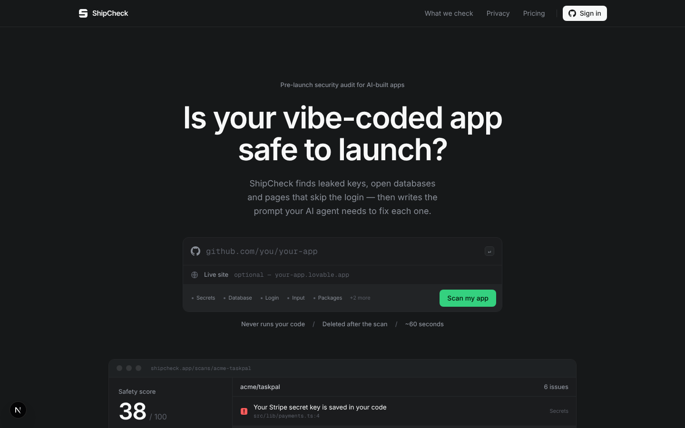
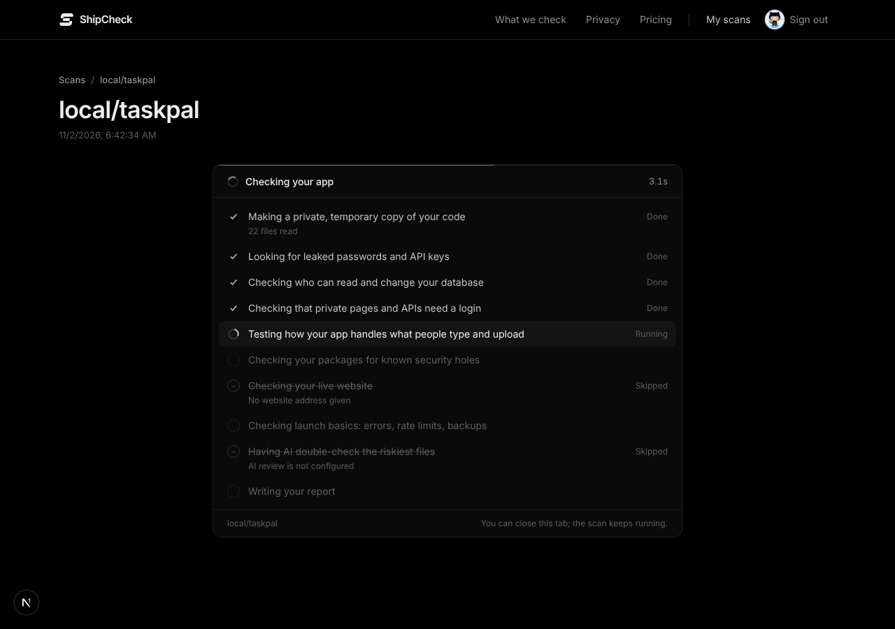
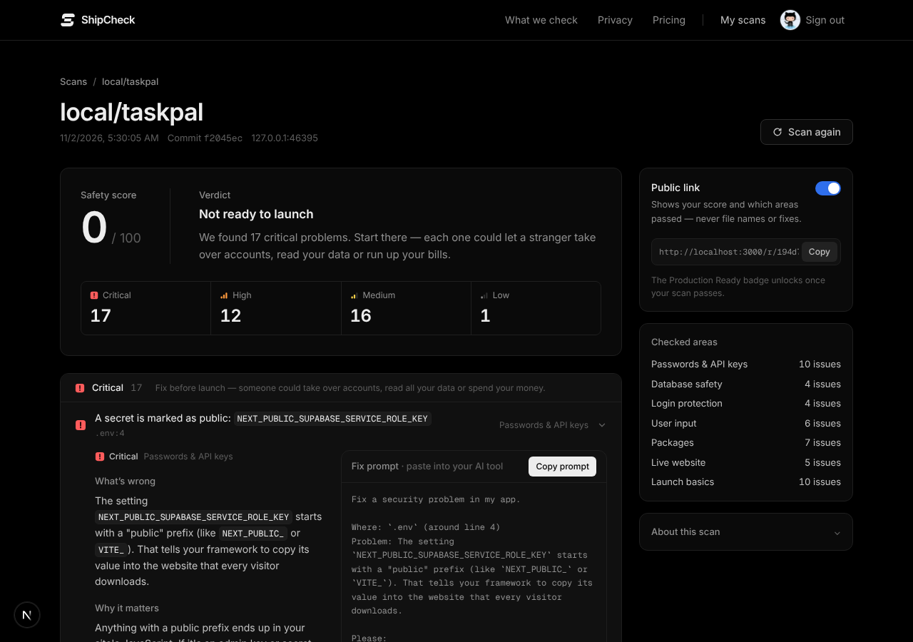
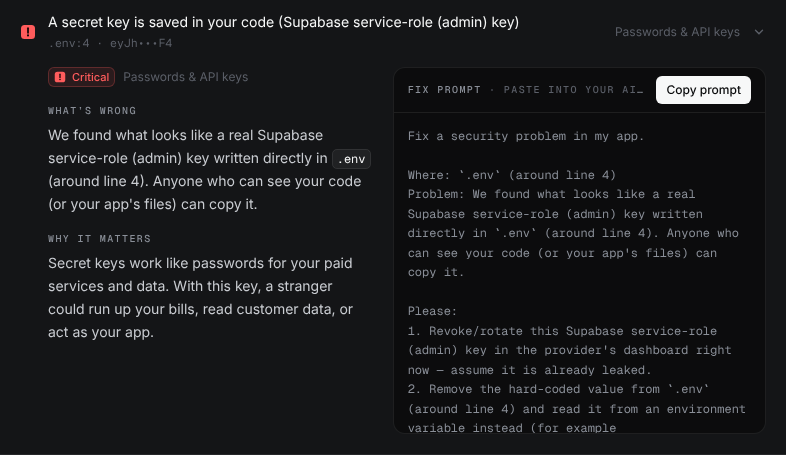
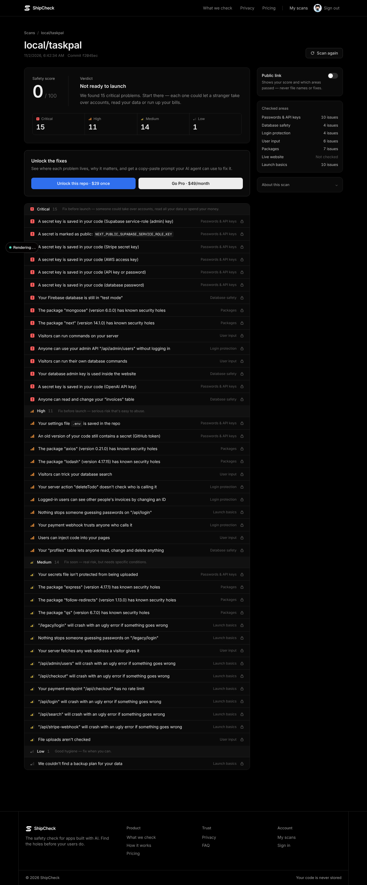
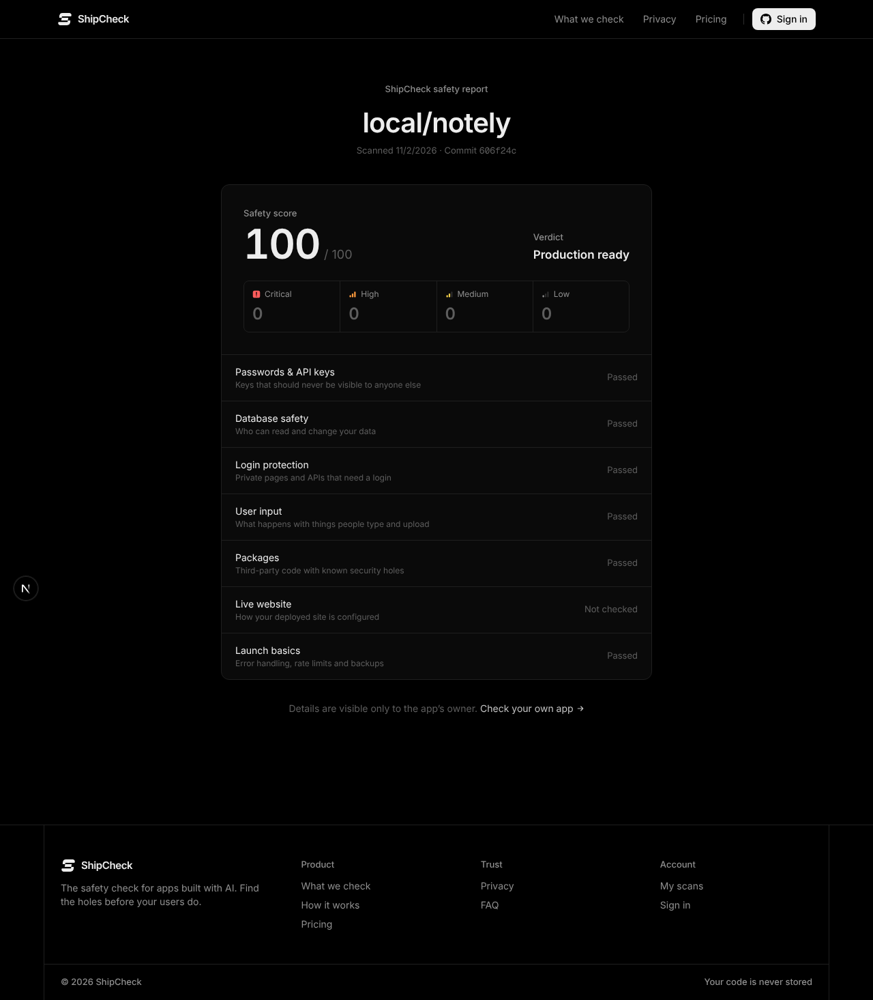
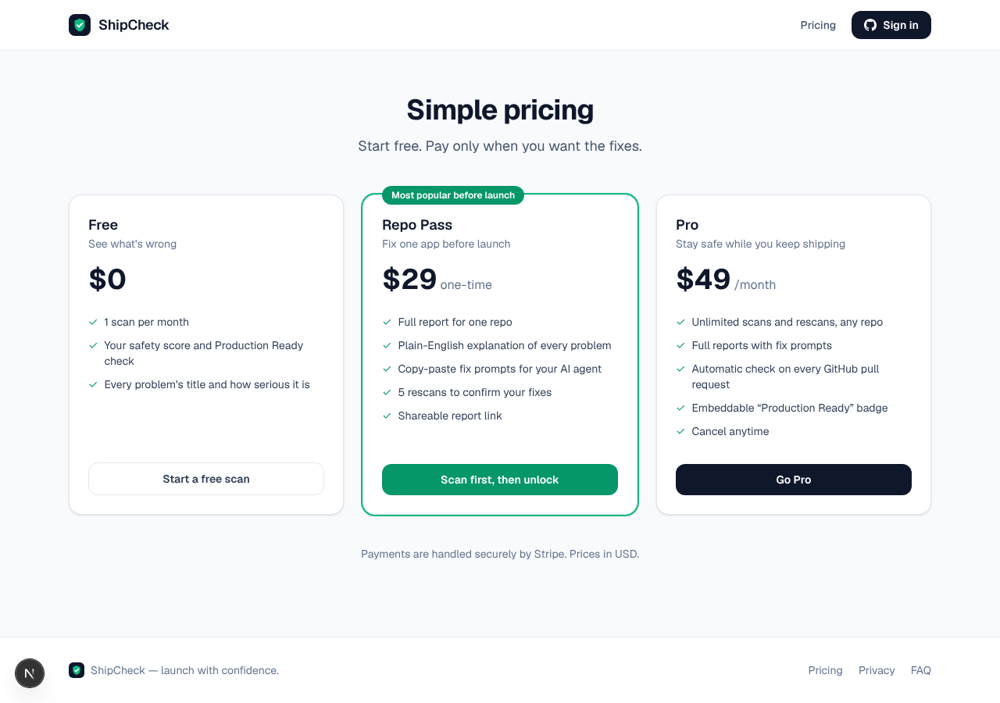

# ShipCheck

**Is your vibe-coded app safe to launch?** ShipCheck is a pre-launch safety audit for apps built with Lovable, Bolt, Cursor, Replit and v0.

Paste a GitHub repo, and optionally your live site. ShipCheck clones the repo into a throwaway sandbox and runs Gitleaks, Semgrep, OSV and its own checks for Supabase, Firebase and Next.js. Claude then double-checks the riskiest files. You get a 0–100 score, a pass/fail **Production Ready** badge, and plain-English findings. Each finding comes with a copy-paste **fix prompt** for your AI agent.



| Live progress | Full report | A finding with its fix prompt |
|---|---|---|
|  |  |  |

| Free report (titles only) | Public share page | Pricing |
|---|---|---|
|  |  |  |

See [docs/ARCHITECTURE.md](docs/ARCHITECTURE.md) for the file structure, data model and safety design.

---

## What it checks

| Area | Examples | How |
|---|---|---|
| Leaked secrets | Stripe/OpenAI/AWS keys in code, committed `.env`, secrets in **Git history**, `NEXT_PUBLIC_*SERVICE_ROLE*`, keys inside live JS bundles | Gitleaks (`dir` + `git`) plus built-in detectors. Supabase JWTs are decoded, so the public `anon` key is **not** flagged but `service_role` is |
| Database | Supabase tables without RLS, `using (true)` policies, service-role key in browser code, Firebase test-mode rules, service-account JSON | SQL/rules analyzers |
| Auth | API routes and server actions with no login check, admin routes, unsigned webhooks, IDOR (`/invoices/[id]` without an ownership filter) | Route discovery for Next.js App/Pages routes, Express, and Supabase edge functions, plus Claude review |
| Input | SQL/NoSQL injection, command injection, `eval`, XSS (`dangerouslySetInnerHTML`, `innerHTML`), SSRF, unvalidated uploads | Custom Semgrep rules (`src/scanner/semgrep/rules`), with a regex fallback |
| Dependencies | Vulnerable versions from package-lock / pnpm / yarn / requirements.txt | OSV.dev batch API. Transitive deps are capped at *medium* and dev deps at *low* |
| Live site | HTTPS and redirect, security headers, public source maps, CORS reflection, reachable `/.env`, `/.git/config`, `/admin`, debug pages | SSRF-guarded fetch. Probes are compared against a random 404 so single-page apps don't cause false alarms |
| Production basics | Routes without error handling, no rate limiting on login/payment, missing migrations, no backup plan | Analyzers |

**Scoring:** criticals cost 20 points, highs 8, mediums 3 (capped at 15), lows 1 (capped at 5). Any critical caps the score at 49, and any high caps it at 74. **Production Ready** means no critical, no high, a score of 80 or more, every check completed, and some app code was actually found.

## Pricing (enforced in `src/lib/plans.ts`)

| Free | Repo Pass — $29 one-time | Pro — $49/month |
|---|---|---|
| 1 scan per calendar month, severity and titles only | Full report + fix prompts for one repo, 6 scans of that repo (first + 5 rescans) | Unlimited scans, full reports, GitHub check on every PR, embeddable badge |

Locked fields are stripped **on the server**. Free-tier HTML never contains file paths or fix prompts.

Public share links show the score and per-area pass/fail, never titles, files or fixes, so a shared report isn't an attack map.

The badge always reflects the **latest** scan of the repo. Failing apps show a neutral "not verified" badge rather than advertising problems.

---

## Setup

### 1. Prerequisites

- Node 20.9+ (22 recommended) and git
- [Gitleaks](https://github.com/gitleaks/gitleaks) 8.19+ and [Semgrep](https://semgrep.dev/docs/getting-started/) on the **worker** machine (`pip install semgrep`). Without them the scanner falls back to built-in detectors and says so in the report.
- A Postgres database: [Supabase](https://supabase.com) or any Postgres 14+

```bash
npm install
cp .env.example .env.local
```

Generate the two secrets:

```bash
openssl rand -hex 32
```

Put one value in `SESSION_SECRET` and another in `ENCRYPTION_KEY`.

### 2. Database (Supabase)

1. Create a Supabase project, then open **Project Settings → Database → Connection string (URI)**. Use the session pooler (port 5432) for the worker. Use the transaction pooler (port 6543) for serverless web hosting. Put it in `DATABASE_URL`.
2. Apply the schema:

```bash
npm run db:migrate
```

Every table has Row Level Security enabled and **no policies**. The app only talks to Postgres from the server, so Supabase's public anon key can't read anything. Don't add anon policies.

### 3. GitHub login (OAuth App)

GitHub → Settings → Developer settings → **OAuth Apps → New**:

- Homepage URL: your `APP_URL`
- Callback URL: `${APP_URL}/api/auth/github/callback`

Set `GITHUB_CLIENT_ID` and `GITHUB_CLIENT_SECRET`.

Login asks only for `read:user user:email`. "Connect private repos" re-authorises with `repo` scope. User tokens are stored AES-256-GCM encrypted.

### 4. PR checks + read-only private access (GitHub App, optional, Pro)

GitHub → Developer settings → **GitHub Apps → New**:

- Webhook URL: `${APP_URL}/api/github/webhook`. Generate a webhook secret and put it in `GITHUB_APP_WEBHOOK_SECRET`.
- Repository permissions: **Contents: read**, **Checks: read & write**, **Metadata: read**
- Subscribe to events: **Pull request**. Installation events are sent automatically.
- Upload `docs/brand/app-icon-512.png` as the app logo.
- Generate a private key. Put it in `GITHUB_APP_PRIVATE_KEY` with newlines escaped as `\n`. Set `GITHUB_APP_ID` and `GITHUB_APP_SLUG`.

When a Pro user installs the app, every opened or updated PR gets a **ShipCheck** check run: green when Production Ready, red otherwise, with a link to the report. The worker prefers the app's read-only installation token over the user's OAuth token when cloning.

### 5. Stripe

1. Create a product with two prices: **$29 one-time** and **$49 monthly recurring**. Put their IDs in `STRIPE_PRICE_REPO` and `STRIPE_PRICE_PRO`.
2. Set `STRIPE_SECRET_KEY`.
3. Add a webhook endpoint at `${APP_URL}/api/stripe/webhook` with these events: `checkout.session.completed`, `checkout.session.async_payment_succeeded`, `customer.subscription.created`, `customer.subscription.updated`, `customer.subscription.deleted`. Put its signing secret in `STRIPE_WEBHOOK_SECRET`.
4. In **Settings → Branding**, upload `docs/brand/app-icon-512.png` as the icon so Checkout shows the ShipCheck mark.
5. Turn on the **Customer portal** in Stripe settings; the "Manage billing" button uses it.

For local development, forward webhooks with the Stripe CLI:

```bash
stripe listen --forward-to localhost:3000/api/stripe/webhook
```

Use the `whsec_…` value it prints as `STRIPE_WEBHOOK_SECRET`.

Fulfilment is idempotent. It runs from both the webhook and the success redirect, so users don't wait on webhook latency.

### 6. Claude (optional but recommended)

Set `ANTHROPIC_API_KEY`. The worker sends only the riskiest files (up to about 45k tokens) to `claude-opus-5-5`, with anything secret-looking redacted first. Claude rewrites explanations for that exact code, can dismiss heuristic false positives (never secrets, packages or live-site facts), and can add grounded findings it can point to by file and line.

Requests use `fallbacks: "default"`, so a rare safety-classifier refusal on security content is retried on Anthropic's recommended fallback model. If the review fails or is refused, the report falls back to the built-in plain-English templates. Override the model with `SHIPCHECK_MODEL`.

### 7. Run it

Start these in two terminals:

```bash
npm run dev
```

```bash
npm run worker
```

Open http://localhost:3000.

### Deploying

- **Web:** any Next.js host (Vercel, Render, Fly…). It needs no binaries.
- **Worker:** a long-running container with git, Gitleaks and Semgrep. Use `Dockerfile.worker`, then run as many replicas as you like; jobs are claimed with `FOR UPDATE SKIP LOCKED`.

```bash
docker build -f Dockerfile.worker -t shipcheck-worker .
```

  Give it a few GB of disk for temp clones, and set `WORKER_CONCURRENCY` (default 2). Stale jobs are re-queued after 30 minutes, and a scan is retried at most twice.

---

## Testing

The test suite builds a deliberately insecure sample app ([`samples/insecure-app`](samples/insecure-app), "TaskPal") into a real two-commit git repo with freshly generated **fake** keys. It then asserts that every planted problem is found. It also checks a clean sample ([`samples/secure-app`](samples/secure-app)) for zero false positives.

```bash
npm test
```

The suite covers:

- every planted problem per check category, plus the anon-key and safe-table non-findings
- no full secret ever stored
- the fallback mode without Gitleaks/Semgrep
- the live-site checks against an insecure local server and a hardened single-page app
- the SSRF guard, scoring, repo-URL parsing and Supabase/Firebase rule parsing
- the Claude merge logic (mocked client: redaction, dismissals, hallucinated-file rejection, refusal fallback)
- empty repos and GitHub webhook HMAC

Try the scanner by hand. First build the sample repo:

```bash
npm run sample:make -- insecure-app /tmp/taskpal
```

Then scan it (a live site URL is optional):

```bash
npm run scan:local -- /tmp/taskpal
```

**End-to-end smoke test** against a running dev server and worker. It covers CSRF and session guards, cross-user isolation, free-tier stripping, the Stripe webhook, share links and badges. First set `SHIPCHECK_ALLOW_LOCAL_REPOS=1` and `SHIPCHECK_ALLOW_PRIVATE_TARGETS=1` in `.env.local`. Then build both samples:

```bash
npm run sample:make -- insecure-app /tmp/taskpal
```

```bash
npm run sample:make -- secure-app /tmp/notely
```

Then run the smoke test:

```bash
npx tsx --env-file=.env.local scripts/smoke.ts /tmp/taskpal /tmp/notely
```

Those two dev switches are ignored when `NODE_ENV=production`.

## Safety model, in short

- **Never executes user code:** no install, build or hooks. Clones use `core.hooksPath=/dev/null`, `core.symlinks=false`, no submodules and no LFS.
- **Clones are deleted:** the repo is fetched shallowly into a temp dir and removed in `finally`. Only findings are stored, with secrets masked (`sk_l•••9f`).
- **Untrusted input is never trusted:** repo URLs are parsed to `owner/repo` and rebuilt, and tokens go through env-based git config, never argv or URLs. Repo-supplied `.gitleaks.toml` / `.semgrepignore` files are deleted before scanning.
- **Live-site probes are SSRF-guarded:** http(s) only, private/loopback/metadata IPs blocked on every redirect hop, with timeouts and size caps.
- **The app follows its own advice:** security headers, a CSP, no public source maps, RLS on every table, same-origin checks on state-changing routes, and signed webhooks.

## Known limitations (v1)

- The static checks are heuristics tuned for JS/TS apps (Next.js, Vite/React, Express, Supabase, Firebase). Python and other stacks get secrets, dependency and live-site checks, and Claude review if enabled.
- The Firebase check reads rules files in the repo. It can't see rules edited only in the Firebase console, and the same applies to Supabase policies created only in the dashboard. If no migrations are committed, ShipCheck reports that instead.
- "Backups" can only be inferred from the repo, so that finding is deliberately low severity.
- Polling (1.5s) drives the progress UI. Swap in Supabase Realtime or SSE if you need instant updates.

## Brand assets

The ShipCheck mark lives in [`docs/brand/`](docs/brand): `logo-white.svg` / `logo-black.svg` (transparent), `app-icon.svg` (on the dark background), and 512px PNGs of each for places that need an upload. In code it's `src/components/Logo.tsx`, and the browser tab icon is `src/app/icon.svg`.

